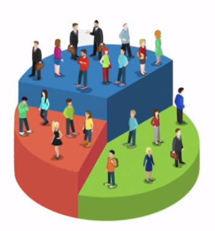

# 🛒 Segmentação de Clientes com K-Means

**Descobrindo perfis de clientes para direcionar o lançamento de um novo produto.**

<div align="center">

</div>

**Python · Pandas · Scikit-learn · K-Means · Streamlit · CRISP-DM**

| 📊 Destaques | |
|---|---|
| Clientes analisados | **2.203** (após limpeza) |
| Segmentos encontrados | **4 perfis** de comportamento de compra |
| Público prioritário | **48% dos clientes**, que concentram **~89% do gasto total** |
| Impacto na campanha | **~52% menos contatos** (1.048 em vez de 2.203 clientes), mantendo quase todo o potencial de receita |
| Técnica | **K-Means** validado com Silhouette, PCA, análise de sensibilidade e comparação com clusterização hierárquica |
| Entrega | Modelo em **Pipeline** do scikit-learn + **app Streamlit** para classificar novos clientes |

---

## 📑 Sumário

1. [Contexto do problema](#1-contexto-do-problema)
2. [Objetivo](#2-objetivo)
3. [Base de dados](#3-base-de-dados)
4. [Estrutura do projeto](#4-estrutura-do-projeto)
5. [Como executar](#5-como-executar)
6. [Etapas do projeto (CRISP-DM)](#6-etapas-do-projeto-crisp-dm)
7. [Principais descobertas da análise exploratória](#7-principais-descobertas-da-análise-exploratória)
8. [Construção da solução](#8-construção-da-solução)
9. [Perfis de clientes encontrados](#9-perfis-de-clientes-encontrados)
10. [Resposta à pergunta de negócio](#10-resposta-à-pergunta-de-negócio)
11. [App interativo (Streamlit)](#11-app-interativo-streamlit)
12. [Insights](#12-insights)
13. [Limites](#13-limites)
14. [Próximos passos](#14-próximos-passos)

---

## 1. Contexto do problema

Uma empresa varejista vai lançar um **novo produto**. A forma mais simples seria enviar a campanha para todos os clientes, mas isso é **caro** e **pouco eficiente**: muitos clientes não têm perfil para comprar e podem até se incomodar com ofertas que não fazem sentido para eles.

A empresa precisa saber **quem são seus clientes** e **quais grupos têm mais chance de comprar**, para concentrar o investimento de marketing onde ele traz mais retorno.

**Fonte dos dados:** [Customer Personality Analysis – Kaggle](https://www.kaggle.com/datasets/imakash3011/customer-personality-analysis)

## 2. Objetivo

Agrupar os clientes por **semelhança de perfil e de comportamento de compra** e descrever cada grupo, para que o time de marketing saiba **com quem falar e como falar**.

> **Pergunta de negócio:** *Quais grupos de clientes existem na base e qual deles deve ser priorizado na campanha do novo produto?*

Este é um problema **não supervisionado**: não existe uma resposta pronta ("este cliente é do grupo A") para o modelo aprender. O algoritmo descobre os grupos sozinho, olhando para as semelhanças entre os clientes.

## 3. Base de dados

A base tem **2.240 clientes** e **29 colunas**, organizadas em 4 temas:

| Tema | Variáveis | O que mostram |
|---|---|---|
| 👤 **Perfil** | `Year_Birth`, `Education`, `Marital_Status`, `Income`, `Kidhome`, `Teenhome`, `Dt_Customer`, `Recency`, `Complain` | Quem é o cliente: idade, escolaridade, estado civil, renda, filhos, data de cadastro, dias desde a última compra e reclamações |
| 🛍️ **Produtos** | `MntWines`, `MntFruits`, `MntMeatProducts`, `MntFishProducts`, `MntSweetProducts`, `MntGoldProds` | Quanto gastou em 2 anos com vinhos, frutas, carnes, peixes, doces e ouro |
| 📣 **Promoções** | `AcceptedCmp1` a `AcceptedCmp5`, `Response` | Se aceitou (1) ou não (0) cada uma das 6 campanhas de marketing |
| 🏬 **Canais** | `NumWebPurchases`, `NumCatalogPurchases`, `NumStorePurchases`, `NumDealsPurchases`, `NumWebVisitsMonth` | Compras pelo site, por catálogo, na loja e com desconto, e visitas ao site no mês |

## 4. Estrutura do projeto

```
Analise_de_clusters_para_segmentar_os_clientes/
├── Datasets/
│   └── marketing_campaign.csv                         # base original (Kaggle)
├── Imagens/                                           # gráficos gerados pelo notebook
├── Model/
│   ├── modelo_finalizado.sav                          # modelo K-Means treinado
│   ├── pipeline_segmentacao.pkl                       # pipeline usado pelo app (gerado na Fase 05)
│   └── pipeline_segmentacao.json                      # ficha do modelo (pesos, métricas, segmentos, avisos)
├── Notebooks/
│   ├── Análise de Segmentação de Clientes .ipynb      # versão original
│   └── Análise de Segmentação de Clientes - v2.ipynb  # versão reorganizada (CRISP-DM)
├── docs/
│   └── decisoes_analiticas.md                         # registro das decisões do projeto (DA-01 a DA-06)
├── src/
│   ├── graficos.py                                    # funções de gráficos
│   ├── estatistica.py                                 # testes das hipóteses (com tamanho de efeito) e regra do IQR
│   ├── selecao.py                                     # relevância das variáveis (Random Forest + Informação Mútua)
│   └── utils.py                                       # pesos, normalização e preparação de clientes novos
├── app.py                                             # app Streamlit
├── requirements.txt
└── README.md
```

## 5. Como executar

```bash
# 1. Clonar o repositório
git clone https://github.com/RafaelSilva89/Analise_de_clusters_para_segmentar_os_clientes.git
cd Analise_de_clusters_para_segmentar_os_clientes

# 2. Instalar as dependências
pip install -r requirements.txt

# 3. Abrir o notebook e executar todas as células (gera o modelo usado pelo app)
jupyter notebook "Notebooks/Análise de Segmentação de Clientes - v2.ipynb"

# 4. Abrir o app
streamlit run app.py
```

## 6. Etapas do projeto (CRISP-DM)

O projeto segue o **CRISP-DM**, um roteiro padrão de mercado para projetos de dados:

| Fase | O que foi feito |
|---|---|
| **01. Entendimento do negócio** | Definição do problema, do objetivo e do formato da entrega |
| **02. Preparação dos dados** | Limpeza (nulos, erros e outliers pela regra do IQR), análise exploratória com 9 hipóteses (cada uma com teste estatístico e tamanho de efeito), criação de novas variáveis e análise de correlações |
| **03. Modelagem** | Normalização, pesos de negócio, escolha do número de grupos e treino do K-Means |
| **04. Avaliação** | Qualidade e tamanho dos grupos e descrição do perfil de cada segmento |
| **05. Implantação** | Pipeline e ficha do modelo salvos, simulação de um novo cliente e app Streamlit |

## 7. Principais descobertas da análise exploratória

**Os clientes têm, em sua maioria, entre 30 e 50 anos.**

<div align="center">

</div>

- A idade média é de **45 anos**, e cerca de **89%** dos clientes têm ensino superior.

**Quem ganha mais, gasta mais.**

<div align="center">

</div>

- Renda e gasto crescem juntos (correlação de **0,79**), principalmente acima de **US$ 60 mil/ano**.

**A maioria dos clientes tem filhos.**

<div align="center">

</div>

- **50%** têm 1 filho, **19%** têm 2 e **2%** têm 3. Apenas **29%** não têm filhos.
- E filhos pesam no orçamento: o gasto mediano cai de **US$ 1.188** (sem filhos) para **US$ 308** (1 filho) e **US$ 94** (2 filhos).

**Vinhos e carnes dominam as vendas.**

<div align="center">

</div>

- Vinhos representam **50%** das vendas; vinhos + carnes somam **77,8%**.

**As campanhas melhoraram com o tempo.**

<div align="center">

</div>

- A 2ª campanha foi um fracasso, mas a 3ª, a 4ª e a 5ª tiveram boa aceitação: o marketing aprendeu com os erros.

> 🧪 **Testes estatísticos:** cada hipótese foi testada (binomial, teste t, Spearman, Kruskal-Wallis), sempre com o **tamanho do efeito**. Exemplo: a renda média (US$ 51.959) é estatisticamente diferente de US$ 50 mil, mas a diferença é **desprezível** (d de Cohen de 0,09); já o número de filhos tem efeito **grande** sobre o gasto (épsilon² de 0,24).

## 8. Construção da solução

Abaixo, cada etapa explicada de forma simples:

**1️⃣ Limpeza dos dados**: removemos registros com erros evidentes, como clientes nascidos antes de 1900, rendas acima de US$ 200 mil (até 666 mil, provável erro de digitação) e compras inconsistentes. Restaram **2.203 clientes** (98% da base).

**2️⃣ Criação de novas variáveis**: transformamos as colunas originais em informações mais úteis:

| Nova variável | O que representa |
|---|---|
| `TotalAmountSpent` | **Quanto** o cliente gastou no total |
| Categorias em % | **No que** ele gasta (ex.: 50% em vinho) |
| `TotalPurchases` | **Quantas** compras fez |
| Canais em % | **Onde** compra (site, catálogo ou loja) |
| `AcceptedCmp` | Quantas campanhas aceitou (de 0 a 6) |
| `ChildrenHome` | Total de filhos em casa |
| `LifeTime` | Há quantos meses é cliente |

**3️⃣ Colocando tudo na mesma régua (normalização)**: o algoritmo compara clientes pela "distância" entre eles. Sem ajuste, uma renda de 80.000 pesaria muito mais que um percentual de 0,5 só por ser um número maior. Por isso, todas as variáveis foram convertidas para uma escala de **0 a 1**.

**4️⃣ Pesos de negócio**: algumas características importam mais para o marketing. O **gasto total** recebeu o maior peso (8), seguido pelo **número de compras** (6) e por renda, recência, visitas ao site e tempo de cliente (4).

**5️⃣ Quantos grupos criar?** Testamos de 2 a 10 grupos com duas medidas: o **Método do Cotovelo** (o quanto os clientes de cada grupo ficam próximos entre si) e o **Silhouette Score** (o quanto os grupos ficam separados uns dos outros).

<div align="center">

</div>

- Estatisticamente, **2 grupos** separam melhor os clientes, mas isso apenas divide a base em "gasta muito" x "gasta pouco", o que o marketing já sabe.
- Com **4 grupos**, cada metade se divide em perfis que pedem **ações diferentes** (ex.: entre quem gasta pouco, quem acabou de comprar x quem está sumindo), com perda pequena de separação. Por isso escolhemos **4 grupos**.

**6️⃣ Treinando o K-Means**: o algoritmo coloca cada cliente no grupo mais parecido com ele.

> 💡 **Analogia:** é como organizar os convidados de uma festa em 4 mesas, colocando pessoas parecidas na mesma mesa.

**7️⃣ Os grupos são confiáveis?** Três verificações:

| Verificação | Pergunta que responde | Resultado |
|---|---|---|
| **Silhouette Score** + gráfico **PCA** | Os grupos estão bem separados entre si? | **0,18**: grupos com sobreposição, algo comum em dados de clientes (o comportamento de compra é contínuo). Os perfis, porém, são bem diferentes entre si |
| **Sensibilidade aos pesos** | Os grupos mudam muito se tirarmos os pesos de negócio? | **Sim** (concordância de 0,20): sem pesos, o modelo agrupa por "no que compra"; com pesos, por "quanto vale o cliente", que é o objetivo do projeto |
| **Clusterização Hierárquica** | Outro algoritmo encontra grupos parecidos? | **Em parte** (concordância de 0,37). O K-Means separa melhor (0,18 x 0,14) e classifica clientes novos, por isso foi mantido |

<div align="center">

</div>

- No gráfico, o eixo horizontal funciona como um **eixo de valor**: da esquerda para a direita estão os grupos de baixo gasto (que se sobrepõem), os *Fiéis de alto volume* e os *Premium*.

**8️⃣ Pronto para uso**: todas as etapas (normalização, pesos e K-Means) foram empacotadas em um único **Pipeline**, que garante que um cliente novo passe exatamente pelo mesmo tratamento dos dados de treino.

**🔍 Quais variáveis mais definem os grupos?** Depois do K-Means, usamos o **cluster como alvo** e medimos a relevância de cada variável com dois métodos: **Random Forest** e **Informação Mútua**. Os dois colocam o **gasto total** em 1º lugar, seguido do **total de compras** e da **renda**, exatamente as variáveis com os maiores pesos de negócio. A **recência** é decisiva para separar os dois grupos de baixo gasto.

<div align="center">

</div>

## 9. Perfis de clientes encontrados

| Segmento | Clientes | Renda média | Gasto médio (2 anos) | Características | Ação recomendada |
|---|---|---|---|---|---|
| 🥇 **Premium** | 419 (19%) | US$ 77 mil | **US$ 1.606** | Maior ticket médio, compram por catálogo e na loja, quase não usam desconto, **mais aceitam campanhas** | 🎯 **Prioridade do lançamento**: ofertas exclusivas, sem desconto |
| 🍷 **Fiéis de alto volume** | 629 (29%) | US$ 64 mil | US$ 825 | Compram com frequência, mais velhos, preferem **vinhos** | 🎯 **Segundo público**: combos e programa de fidelidade |
| 🌱 **Novos e ativos** | 587 (27%) | US$ 37 mil | US$ 127 | Mais jovens, cadastro recente, compraram há pouco tempo, sensíveis a desconto | Campanhas digitais com desconto para aumentar o ticket |
| ⚠️ **Em risco de churn** | 568 (26%) | US$ 37 mil | US$ 132 | ~75 dias sem comprar, compram com desconto, **menor aceitação de campanhas** | Reativação com cupons e produtos para a família |

> **Legenda dos gráficos abaixo:** cluster 0 = Fiéis de alto volume · 1 = Em risco de churn · 2 = Premium · 3 = Novos e ativos.

<div align="center">

</div>

- O segmento **Premium** gasta muito mais que todos os outros grupos.

<div align="center">

</div>

- Os dois grupos de menor gasto se diferenciam pela **recência**: um comprou recentemente (*Novos e ativos*), o outro está deixando de comprar (*Em risco de churn*).

## 10. Resposta à pergunta de negócio

> **Priorizar o segmento Premium e, em seguida, os Fiéis de alto volume.** Juntos, eles são **48% dos clientes**, mas respondem por **~89% de todo o gasto** da base, e o segmento Premium é o que mais aceita campanhas de marketing.
>
> Na prática, a campanha fala com **1.048 clientes em vez de 2.203** (**~52% menos contatos** e, portanto, menos custo), mantendo quase todo o potencial de receita.

## 11. App interativo (Streamlit)

Para que o time de marketing use o modelo **sem precisar de código**, o projeto tem um app em Streamlit:

1. Preencha os dados do cliente (renda, gastos por categoria, compras por canal etc.).
2. Clique em **Identificar segmento**.
3. O app mostra o **segmento**, a **ação de marketing recomendada** e uma comparação do cliente com a média do segmento.

```bash
streamlit run app.py
```

> ℹ️ O app usa o arquivo `Model/pipeline_segmentacao.pkl`, gerado ao executar o notebook até a Fase 05.

<!-- Adicione aqui um GIF de demonstração do app:  -->

## 12. Insights

1. **Poucos clientes geram a maior parte da receita**: 19% dos clientes (Premium) respondem por **50% do gasto total**.
2. **Desconto não é necessário para todos**: o segmento Premium faz só 8% das compras com desconto. Oferecer promoção a eles reduz a margem sem necessidade.
3. **Existe um grupo em risco de churn**: 26% dos clientes estão há ~75 dias sem comprar e quase não respondem a campanhas.
4. **Vinho é o carro-chefe**: é a principal categoria para todos os segmentos, especialmente para os Fiéis de alto volume (53% do gasto).
5. **Filhos em casa reduzem o gasto**: o gasto mediano de quem não tem filhos (US$ 1.188) é quase 4 vezes o de quem tem 1 filho (US$ 308), e quem tem filhos compra mais com desconto.

## 13. Limites

- Os **pesos** das variáveis foram definidos por critério de negócio e **influenciam bastante** os grupos (concordância de apenas 0,20 com o modelo sem pesos). Eles devem ser validados com o time de marketing.
- Os grupos têm **sobreposição** (Silhouette de 0,18), principalmente entre os dois segmentos de baixo gasto, que se diferenciam sobretudo pela recência.
- A base é de **2012–2014** e pode não refletir o comportamento atual dos clientes.
- A versão original do modelo não fixava a semente aleatória (`random_state`). A **v2** corrige isso para tornar o resultado reproduzível.
- A segmentação mostra **quem priorizar**, mas o ganho real só pode ser confirmado medindo o resultado da campanha.
- A melhora das campanhas ao longo do tempo (H6) é uma leitura de negócio: com só 5 campanhas, o teste estatístico não tem força para confirmá-la.

## 14. Próximos passos

1. **Medir o resultado** da campanha por segmento com um teste A/B.
2. **Publicar o app** no Streamlit Community Cloud e adicionar um GIF de demonstração.
3. **Refinar os perfis** com análises dentro de cada grupo (mix de produtos e canais preferidos).
4. **Atualizar a segmentação periodicamente**, já que o comportamento dos clientes muda com o tempo.

---

📫 **Contato:** [GitHub](https://github.com/RafaelSilva89) · [Portfólio](https://rafaelsilva89.github.io/portfolioProjetos/)
